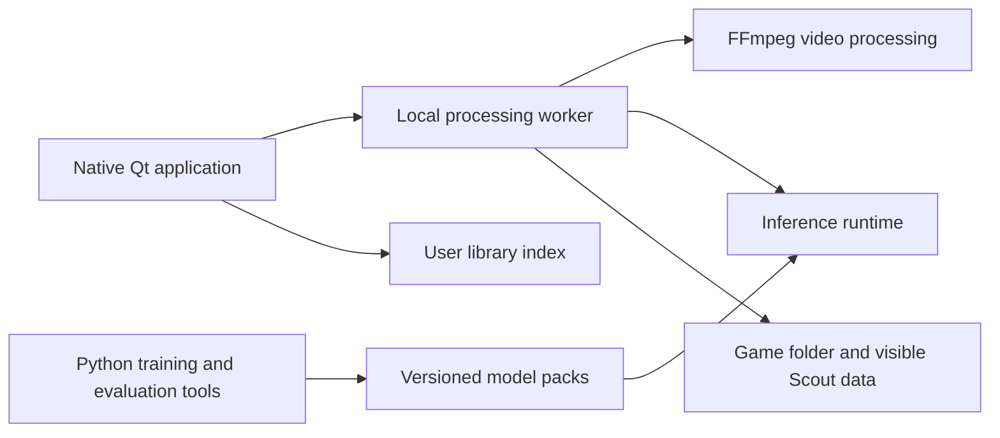

# Scout Studio: future path

[README](../README.md) · [Development](development.md) · [Code map](code-map.md)

Status: proposed roadmap, recorded 4 November 2026. This describes future work,
not features already shipped. Follow the [installation guide](installation.md)
and [development guide](development.md) for the current application.

Progress on 5 November 2026: the [isolated detector benchmark](detector-benchmark-2026-11-05.md)
records a partial phase0 CPU/GPU baseline. Phase1 now has candidate manifests,
post-uninstall test evidence and a separate tag-promotion workflow that verifies
and copies tested installer bytes. Local fixture checks cover identity, test and
hash rejection paths; hosted workflow execution remains unverified. Signing,
platform dependency locks, upgrade checks and the remaining phase0 measurements
are still pending, so neither phase is marked complete.

Phase2 implementation now uses Qt local application-data defaults, preserves
explicit/remembered portable workspaces and offline paths, and offers registry
backup/import in the Library menu. Imports preserve unsaved UI edits and use
backups, writer locks and digest checks. Native platform validation remains open.

Phase1 dependency snapshots now cover all four Python3.12 targets with exact
transitive versions and wheel hashes, including CPU/CUDA and Intel macOS
constraints. Target-aware regeneration was independently repeated. CI installs
them into fresh isolated environments and rejects drift; native builds and
upgrade execution still need hosted validation.

Phase3 now has version1 worker inputs/events/results, unique job snapshots and
verified queue completion. Cancellation/process-tree cleanup remains in place.
Training/reference dependencies are optional extras; a fresh-process check
blocks their imports while starting the native UI and exporting a synthetic
clip. Frozen installed-worker smoke coverage is configured but not executed
locally. The default standalone profile still includes reference dependencies
for compatibility; reduced-runtime packaging follows model-pack validation.

Phase4's classifier prototype exports validated numeric binary HGB trees to
JSON and evaluates them with NumPy. Synthetic threshold/NaN probes and final
interval comparisons match scikit-learn within `1e-12`; independently reviewed.
Production-model and held-out-game equivalence remain required before adoption.

## Product goal

Someone should be able to download Scout Studio, install it, select a game
folder, detect plays, correct their boundaries, and export clips without knowing
Python, Git, or the repository layout. A tested baseline model should allow that
workflow offline. Video and saved reviews stay under the user's control.

Keep Python and native Qt as the starting point. Improve the runtime and release
architecture incrementally. A complete language or GUI rewrite needs measured
evidence that a specific requirement cannot reasonably be met with this stack.

## Starting point

| Area | Current implementation | Intended direction |
| --- | --- | --- |
| Interface | Python/PySide6 native desktop | Retain native Qt; separate presentation from processing |
| Processing | Version1 local job/event/result interface adapting existing CLI commands | Validate installed worker and preserve compatibility |
| Detection | Ultralytics/PyTorch person detection, features and tracking | Evaluate an inference-only runtime with equivalent results |
| Play classifier | scikit-learn histogram gradient boosting, saved with pickle | Evaluate an exported inference model; retain Python training tools |
| Dependencies | Base media/review runtime, optional reference/training/inference extras | Reduce standalone contents after model-pack validation |
| Models | Installers exclude detector weights and trained classifiers | Deliberately publish approved, versioned model packs with an offline baseline |
| Library | Workspace-local `.scout-library.json`; game data in `Scout/` | Store the installed app's index in standard user data; preserve portable game folders |
| Releases | Main/PR candidate builds; tags verify and promote tested installers | Sign final candidates before tests; complete hosted promotion and upgrade validation |
| Updates | Manual installer downloads | A clear download page and an in-app update flow |

Existing modules and responsibilities are listed in the [code map](code-map.md).
These boundaries can evolve without changing the `scout` import package or
breaking existing CLI commands.

## Target architecture

The interface owns navigation, playback controls and review editing. The worker
owns long processing operations. Training remains available as a separate
developer tool. Reviewing corrections must still produce useful training data
without requiring users to install the training environment.

The proposed inference runtime is a decision to validate, not a dependency to
replace immediately. ONNX Runtime is a candidate; adopting it requires proving
the complete detector-to-play pipeline, not just loading an exported model.

## Phase 0: establish a reproducible baseline

Record the current product before changing its engine or packaging tool:

- Cold startup time and time until a match is usable.
- Installer size, installed size and model size separately.
- Peak memory and end-to-end processing time on named CPU/GPU hardware.
- Time spent decoding, resizing, detecting, tracking, building features,
  classifying, segmenting and encoding.
- Held-out-game detection quality, boundary errors and manual correction effort.

Keep a reference set of source order, frame rates, model versions, probabilities
and resulting play intervals. Use synthetic fixtures in public CI and a separate
private evaluation set for representative footage. Do not upload personal match
recordings or train on them merely to validate packaging.

**Exit gate:** measurements are repeatable, dependencies and model identities are
recorded, and equivalence tolerances are agreed before evaluating replacements.
No installer-size or speedup target is claimed until it is measured.

## Phase 1: publish tested installers without rebuilding

Make this the first delivery improvement. Rebuilding after a successful branch
run introduces another opportunity for dependency drift or transient packaging
failures.

1. Build candidates for a specific commit and application version using pinned
   platform dependency sets.
2. Sign the final Windows binaries/installers and sign/notarize the macOS app
   and distribution image. Complete all byte-changing steps before testing.
3. Install and test those final artifacts on fresh machines for each supported
   operating system and architecture.
4. Save a release manifest containing the commit, version, platform, minimum
   supported OS, build identity, artifact hashes and relevant model versions.
5. Promote those exact artifacts to a release. Promotion checks the trusted build
   identity, matching tag/version, required test results and recorded hashes.

Retain candidates long enough to allow promotion. If an artifact expires or any
binary changes, rebuild and retest it before release. Never silently substitute
an untested installer. A tag or release approval selects a verified candidate;
it does not trigger a second compilation of the product.

Extend existing installer checks to cover an upgrade from the previous released
version, launch through installed shortcuts, model availability, playback, export,
cancellation and uninstall. Include native icon/signature checks and real desktop
smoke checks; offscreen tests alone do not establish the full user experience.

**Exit gate:** the published installer hashes match the tested candidate hashes
on every supported target. A failed build, install, upgrade or smoke check blocks
promotion. Signing credentials and the distribution channel must be configured
before claiming signed releases are available.

## Phase 2: make installed libraries independent of the checkout

The installed application should have a stable, discoverable user-data location
for its library index and preferences. Use Qt's standard platform paths and an
explicit application identity instead of depending on the launch directory.

- Store the library index in application user data, with an app action to reveal
  or back it up.
- Keep originals in their imported game folders and generated work in the visible
  per-game `Scout/` folder.
- Preserve explicit workspace selection for developers and portable libraries.
- Offer an explicit import of an existing index, with backup and conflict handling;
  do not silently merge or overwrite competing game lists.
- Validate offline drives without deleting their library entries or recreating
  missing folders.

Index migration should move registry information, not footage. Preserve canonical
`Scout/` storage and the existing explicit migration tool for older folder names;
do not reintroduce alternate data-folder read fallbacks.

**Exit gate:** an installed app launched from a shortcut, a terminal or a different
working directory opens the same remembered library. Existing games, settings and
reviews survive migration, application upgrades and uninstall/reinstall.

## Phase 3: separate the application runtime from training

Build on the existing subprocess queue instead of replacing the application.

- Define versioned job inputs, progress events, results and error messages.
- Keep heavy imports and processing out of GUI startup and the Qt event thread.
- Separate runtime, training/evaluation and development dependency groups.
- Preserve one queue, cancellation, child-process cleanup and useful logs.
- Preserve source ordering, cross-file offsets, NTSC/frame conventions, audio
  mapping, cache identity, atomic saves, review conflicts, backups and undo.

Existing CLI commands can remain adapters to the same processing interfaces.
Training exports a model pack consumed by the worker; the GUI should not need to
import training libraries to browse a game or edit a review.

**Exit gate:** review and export work with training dependencies absent. Worker
changes pass the existing media/review integrity checks and interrupted-job tests.

## Phase 4: validate a smaller inference runtime

Prototype ONNX inference for both the person detector and play/non-play classifier
behind an explicit backend choice. Keep the existing engine as the reference
until comparisons pass.

Match detector preprocessing, channel order, resizing/letterboxing, normalization,
confidence filtering, NMS and coordinate scaling. Also match feature ordering,
temporal windows, sampling rate, smoothing, hysteresis and segmentation settings.
Small probability differences near a threshold can change play boundaries.

Compare raw model outputs and final play intervals on held-out games, including
camera joins, fractional frame rates, no-play sections and short/long plays.
Measure installer size, memory and processing time with the replacement runtime.
CPU operation is the required baseline; add hardware acceleration only for tested
providers and driver combinations with a working CPU fallback.

**Exit gate:** documented numerical and boundary tolerances pass, quality remains
acceptable, and measured deployment/performance benefits justify the switch.
Otherwise retain the current backend. Never overwrite edited reviews or discard
working caches simply to compare engines; use isolated evaluation outputs.

## Phase 5: version and distribute model packs

Ship a tested baseline detector and play classifier for first-use offline
operation. Version them independently so improvements do not require downloading
the entire application again.

A pack manifest should identify the model hashes, compatible engine versions,
feature/preprocessing schema, sampling assumptions and required postprocessing.
Record the pack identity with generated predictions and include prediction-changing
dependencies in cache invalidation.

Select baseline models deliberately and confirm they can be redistributed. Use a
separate allowlisted model-pack build; keep personal training data, arbitrary
local `models/` contents and downloaded weights out of application source/wheel
archives. This phase changes today's model-exclusion policy only through an
explicit, reviewed release input.

Keep the last working compatible pack until a new pack is verified. Downloads
need integrity/authenticity verification and safe interrupted-download handling.
Missing optional packs should not prevent reviewing or exporting saved work.
Model updates must not automatically rerun predictions over corrected reviews.

**Exit gate:** a clean offline installation detects plays with its baseline pack;
compatible model updates work independently and an incompatible or incomplete
pack leaves the existing installation usable.

## Phase 6: finish end-user delivery and updates

Use one download page with clear platform choices and an explicit support matrix.
GitHub Actions can remain the build system behind that page. If source code stays
private, provide an installer channel accessible to intended users without access
to the development repository.

| Platform | Intended delivery |
| --- | --- |
| Windows x64 | Signed per-user `.exe` installer |
| macOS Apple Silicon / Intel | Signed and notarized `.dmg` per architecture |
| Linux | `.deb` for explicitly tested Ubuntu/Debian versions initially |

Broader Linux distribution formats and additional architectures need their own
compatibility checks before being advertised. Keep display branding **Scout
Studio** and no-space artifact names **Scout-Studio**; Debian identifiers remain
lowercase `scout-studio`.

Add an in-app update check with release notes. Verify the update before offering
installation. Apply it after review edits are saved and processing is idle;
never replace a running worker. Preserve game folders, preferences and the
library index. Keep a recovery path to the last working release, and back up
user-data migrations so binary rollback does not strand a newer data format.

**Exit gate:** a nontechnical user completes install, first detection, review,
export and update on a supported machine without Python or a terminal. Upgrade
and recovery tests preserve saved edits and user data.

## Decisions and order of work

Start with baseline measurements and artifact promotion. Then settle the installed
library location and runtime/training boundary. Run a small inference-conversion
prototype before committing to an engine migration or a different packaging tool.
Model packs and application updates follow those compatibility contracts.

Qt's `pyside6-deploy`/Nuitka is worth evaluating against the existing PyInstaller
setup for the reduced runtime. Decide using actual clean-machine builds and
measurements. Changing packagers alone does not remove the cost of shipping large
ML dependencies.

This is an implementation sequence, not a delivery-date commitment. Track each
phase as a focused change with its exit evidence. Narrow native extensions or a
different inference backend are options when profiling supports them; retain the
native Python/Qt application as the working baseline.

## Technical references

- [Qt for Python deployment](https://doc.qt.io/qtforpython-6/deployment/index.html)
- [pyside6-deploy](https://doc.qt.io/qtforpython-6/deployment/deployment-pyside6-deploy.html)
- [ONNX Runtime: training/export and inference examples](https://onnxruntime.ai/docs/get-started/with-python.html)
- [scikit-learn ONNX conversion support](https://onnx.ai/sklearn-onnx/supported.html)
- [Apple notarization](https://developer.apple.com/documentation/security/notarizing-macos-software-before-distribution)
